# SalesforceDX Code Companion

**Note: This is not an official Salesforce product. I created this extension to help my own development workflow for building Salesforce apps. It supplements the Salesforce Official Extension Pack with features like faster save of Apex, LWC, and Visualforce pages. You can also retrieve package metadata from Salesforce orgs in both traditional metadata and SalesforceDX formats, and manage conflicts between local files and the Salesforce org.**

Provides the ability to save Apex Classes, Apex Triggers, Visualforce Pages, Aura Bundles, Lightning Web Component Bundles, and Apex Components to a Salesforce org without source tracking. Also enables retrieving code from unmanaged packages and changesets in both DX and non-DX source formats. You can switch between authenticated orgs with the `CCDX: Switch Org` command. This extension requires the [Salesforce CLI (`sf`)](https://developer.salesforce.com/tools/salesforcecli) and the [mo-dx-plugin](https://github.com/msrivastav13/mo-dx-plugin) (auto-installed on extension activation). Works with both scratch orgs and non-scratch orgs.

It is highly recommended to use alongside the [Salesforce Extension Pack](https://marketplace.visualstudio.com/items?itemName=salesforce.salesforcedx-vscode) to get all the other features the official extensions offer.

# Requirements

1. Install [Salesforce CLI (`sf`)](https://developer.salesforce.com/tools/salesforcecli) for your operating system.
2. The `mo-dx-plugin` is automatically installed when the extension activates. To manually install or update it, run: `sf plugins install mo-dx-plugin`
3. VS Code version 1.30 or later
4. The [Salesforce Extension Pack](https://marketplace.visualstudio.com/items?itemName=salesforce.salesforcedx-vscode) is highly recommended for syntax and language support.
5. Your project workspace must have an `sfdx-project.json` file in the root folder, and you must have authorized your org with Salesforce CLI (e.g., `sf org login web`).
6. Extension activation is shown in the footer with a rocket symbol. Once the extension is active, authorize the project if you haven't already and enjoy faster deploys.

# Features

1. **Retrieve Source in DX Source Format from Managed/Unmanaged Packages and Changesets**

    From the command palette, select `CCDX: Retrieve DX Source From Package`. Provide the name of the managed/unmanaged package in the input box and press enter. This is the recommended source format.

    The source is in the [DX source format](https://developer.salesforce.com/docs/atlas.en-us.sfdx_dev.meta/sfdx_dev/sfdx_dev_source_file_format.htm).

    You will notice that `package.xml` is auto-generated in the manifest directory and source code of the package is retrieved in DX source format in the `force-app` folder.

    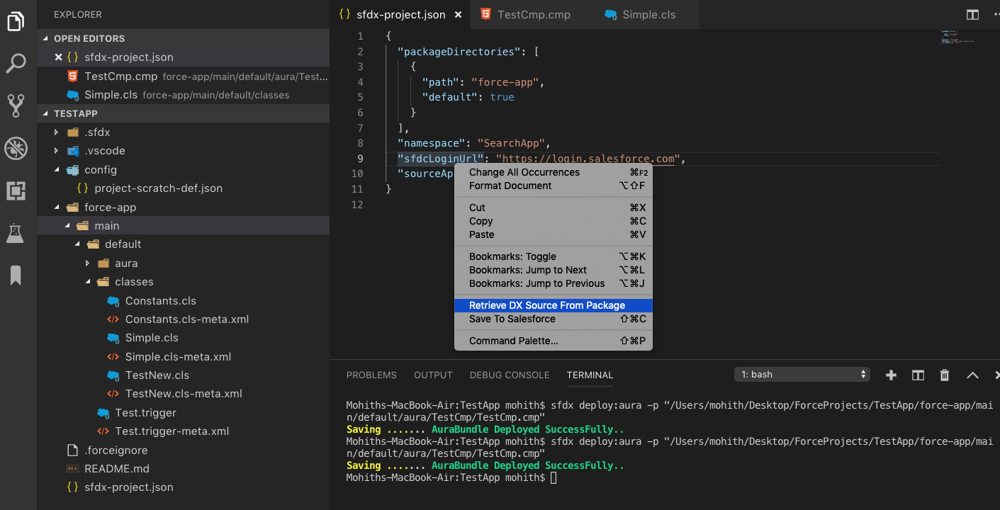

2. **Retrieve Source from Managed/Unmanaged Packages and Changesets in Traditional Metadata Format**

    From the command palette, select `CCDX: Retrieve Source From Package`. Provide the name of the managed/unmanaged package and press enter. Projects not yet moved to the DX format can benefit from this.

    You will notice that `package.xml` is auto-generated and source code of the package is retrieved in the `src` folder. Create a `src` folder if your project does not have one.

    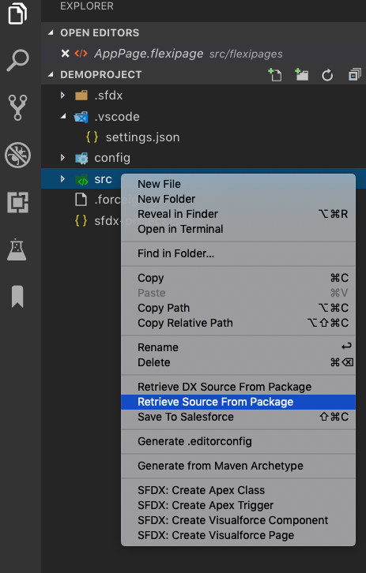

3. **Save Apex Classes, Apex Triggers, Visualforce Pages, and Visualforce Components to Salesforce**

    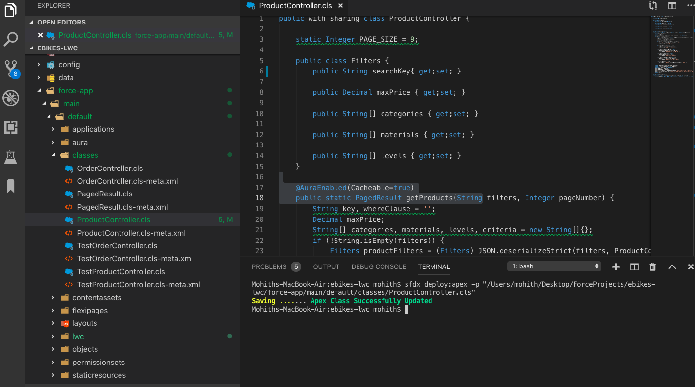

    By default, auto-save is enabled. When you save a file, the extension will deploy it to the Salesforce org you have set as your default.

    If you disable auto-save, you can right-click on the file and select **"Save To Salesforce"**.

4. **Save Lightning Components (Aura and LWC) to Salesforce**

    If you disable auto-save, you can right-click on the file and select **"Save To Salesforce"**.

    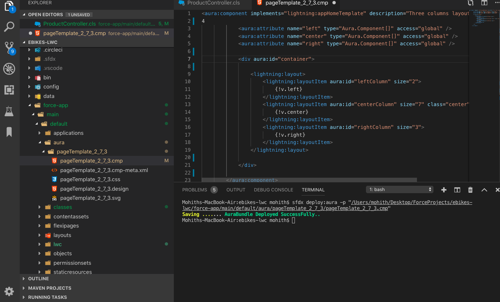

    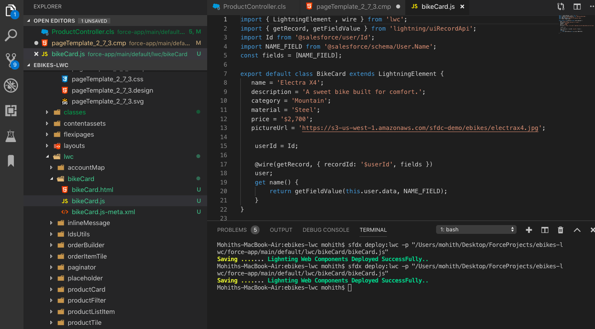

5. **Manage Conflicts with Server**

    This feature is turned off by default. It compares the server copy with the local copy before save and, if a difference is found, you will see a prompt in a diff editor with options to either overwrite or accept the change from the server. You can also manually resolve conflicts and push changes.

    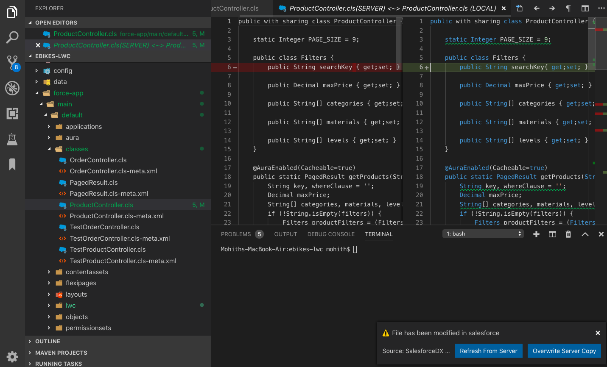

    If you wish to turn this off (e.g., you have VCS for your project and do not develop in a team) for faster save, you can disable the `Manage Conflict` setting in the extension settings.

    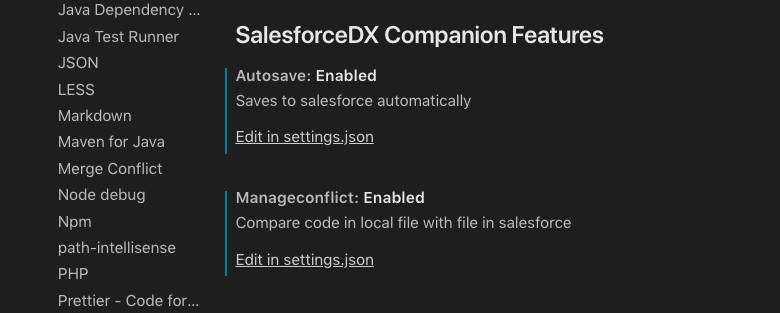

6. **Smart Navigation to VF Page Preview, Lightning App Builder, SLDS Website, Metadata Coverage Report, and Component Library**

    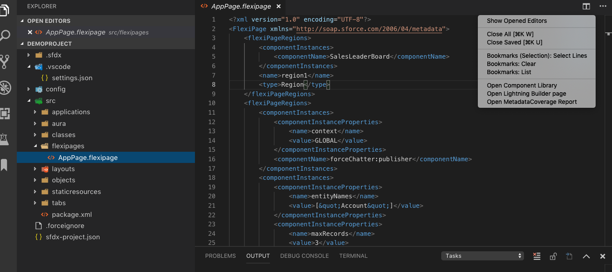

## Display Status of Save and Success

1. When saving files to Salesforce, the status of success or failure is always displayed in the Terminal.
2. The extension relies on the Terminal API, so keep the Terminal open to see errors and progress.

Below screenshot shows how errors are logged:

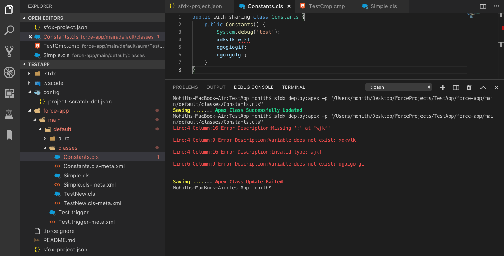

# Video Recordings

https://www.youtube.com/playlist?list=PLDFd1LjbN883y5IlMuU8BCyGhRO-VMuw9

# Issue Reporting

If you find any issues, feel free to log them on the [GitHub Issues](https://github.com/msrivastav13/DX-Code-Companion/issues) page.

You can also reach out to me via Twitter [@msrivastav13](https://twitter.com/msrivastav13).

## Extension Shortcut Keys

To open the command palette and look for all CCDX commands:

| Platform | Shortcut |
|----------|----------|
| macOS | `Cmd+Shift+P` |
| Windows | `Ctrl+Shift+P` |
| Linux | `Ctrl+Shift+P` |

To save the current file to Salesforce:

| Platform | Shortcut |
|----------|----------|
| macOS | `Cmd+Shift+C` |
| Windows | `Ctrl+Shift+C` |
| Linux | `Ctrl+Shift+C` |

# Extension Settings

| Setting | Default | Description |
|---------|---------|-------------|
| `dx-code-companion.autosave.enabled` | `true` | Auto-deploy on file save |
| `dx-code-companion.manageconflict.enabled` | `false` | Compare local file with server before save |
| `dx-code-companion.staticresourcefolder.resourceBundleFoldername` | `"staticresources"` | Folder name for static resource bundles |

# Release Notes

### 0.5.0
1. Migrate all CLI commands from deprecated `sfdx` to `sf`
2. Auto-install `mo-dx-plugin@latest` on extension activation
3. Upgrade `@salesforce/core` from v2 to v8 (uses new `StateAggregator`, `ConfigAggregator`, and `AuthInfo.listAllAuthorizations()` APIs)
4. Replace deprecated `vscode` dev dependency with `@types/vscode` and `@vscode/test-electron`
5. Upgrade TypeScript to v5 and `@types/node` to v18
6. Fix all 29 npm security vulnerabilities
7. Use `sf config set target-org` instead of `sfdx force:config:set defaultusername` for org switching
8. Use `sf project deploy start` instead of `sfdx force:mdapi:deploy` for metadata deployment

### 0.4.8
1. Update npm libraries to latest. Fixes security vulnerabilities.

### 0.4.7
1. Update npm libraries to latest. Fixes security vulnerabilities.
2. Update mo-dx-plugin using `sf plugins update` to get latest CLI plugin.
3. Diff view now respects current UI theme set by user.

### 0.4.6
1. Update npm libraries to latest. Fixes security vulnerabilities.

### 0.4.1
1. Update npm libraries to latest. Fixes security vulnerabilities.

### 0.4.0
1. Fix issues listed [here](https://github.com/msrivastav13/DX-Code-Companion/labels/fixed%20in%200.4.0).
2. Install mo-dx-plugin from the extension context menu directly.

    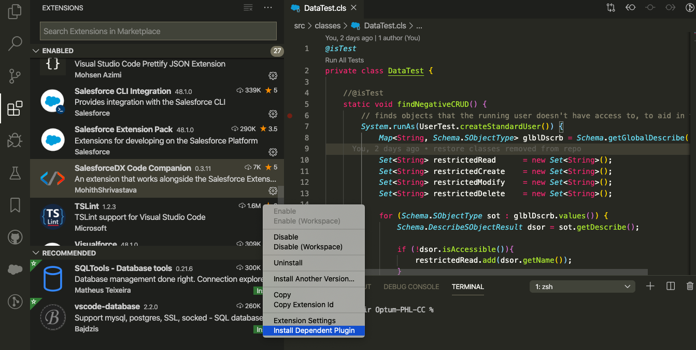

3. Security patch.

### 0.3.9
1. Setting `dx-code-companion.staticresourcefolder.resourceBundleFoldername` to indicate the resource bundle folder name for single page app development. Default value is `"staticresources"`.
2. A static resource folder has an explorer menu to deploy the folder as a static resource bundle.

### 0.3.7
1. Edit static resource files and save to the server. Folders or files should be within a folder named `staticresources`.

### 0.3.6
1. Extension settings now have a UI instead of requiring manual `settings.json` edits.
2. Security patches via npm audit.

### 0.3.3
1. Update `@salesforce/core` to latest version.
2. Fixed auto-save triggering when VS Code opens a folder (now only triggers on manual file save).
3. Removed support for VS Code v1.29.0. Requires v1.30.0 and above.

### 0.3.0
Fully support changeset-driven development ([Trailhead module](https://trailhead.salesforce.com/en/content/learn/modules/declarative-change-set-development/develop-and-test-changes-locally)).

With this release, you can retrieve source from changesets created in your sandbox, edit contents in VS Code, and deploy to target orgs — all without uploading changesets and waiting.

  1. Use the command palette and select `CCDX: Retrieve Source From Changeset`

      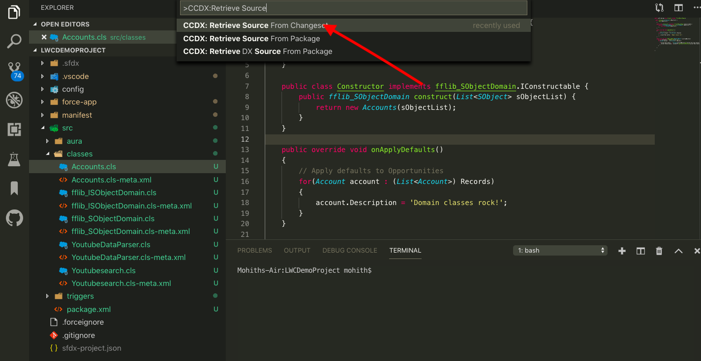

  2. Provide the changeset name in the text box

      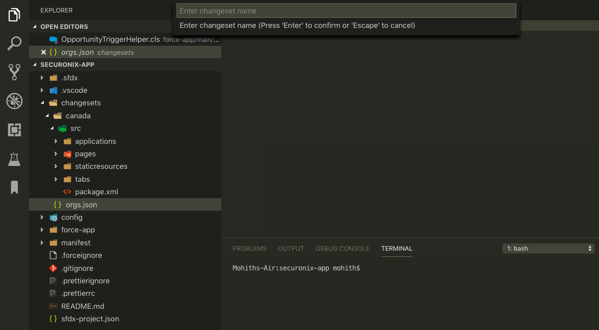

  3. Once retrieved, a subdirectory is created under `changesets/` with a `src` folder containing all the components

      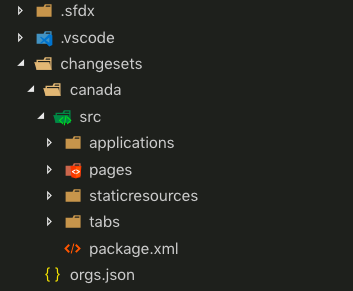

  4. The changeset directory has `orgs.json` — add target orgs using `CCDX: Add Orgs For Changeset Deployment`

      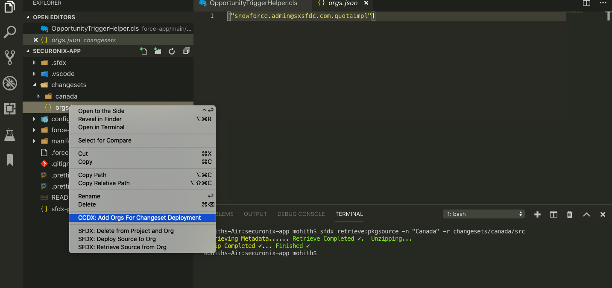
      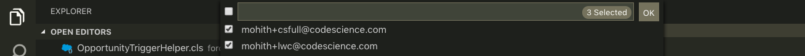

  5. Click on the `src` folder for your changeset to deploy. The interface will ask you to pick an org from the list you added.

      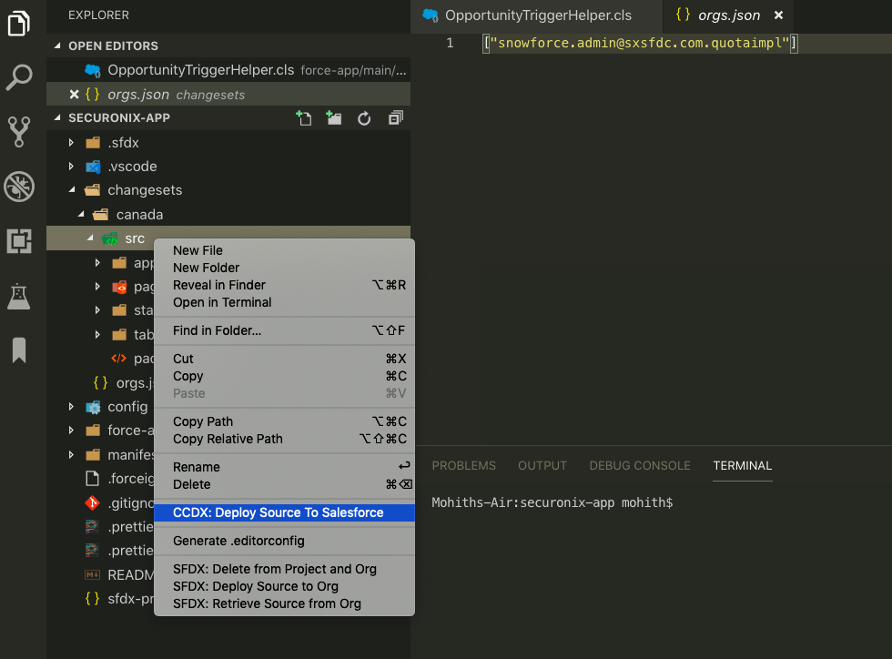

### 0.2.8
1. Fixes connection method to use Salesforce core library native methods.
2. Adds ability to deploy the `src` folder for classic metadata directly from the explorer menu.

    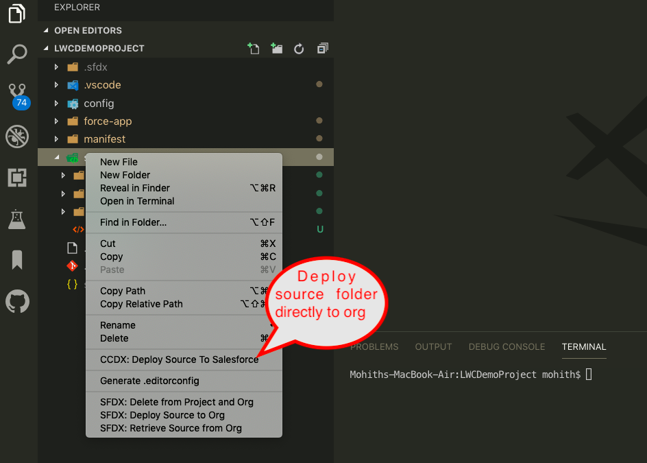

---

### For more information and contribution visit:

* [Mo DX Plugin Repository](https://github.com/msrivastav13/mo-dx-plugin)
* [DX Code Companion](https://github.com/msrivastav13/DX-Code-Companion)

**Enjoy!**
